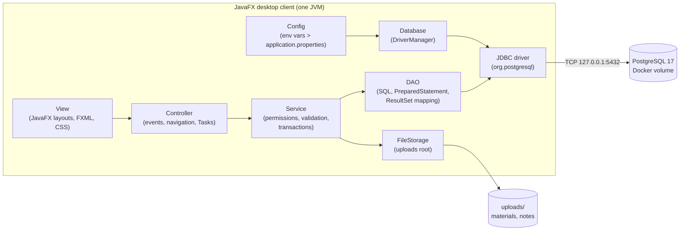

# ClassSync — Application Architecture



## Packages

| Package | Contents |
|---|---|
| `com.classsync` | `Main` (JavaFX `Application` with `init/start/stop`), `Launcher` |
| `config` | `AppConfig` (loads settings), `Database` (creates JDBC connections) |
| `model` | Plain data classes (`User`, `Course`, `Lecture`, …) and enums (`Role`, `LectureStatus`, …) |
| `dao` | One DAO per aggregate. Methods take a `Connection` so a service can run several DAO calls in one transaction |
| `service` | Business rules + authorisation; owns connection/transaction boundaries (`Tx` helper) |
| `controller` / `view` | Screens. Simple screens keep event handlers in the view class; the login screen uses FXML + `LoginController` |
| `util` | `PasswordHasher`, `Validation`, `TimeUtil`, `FileTypes` |
| `tools` | `Migrate` (schema migrations), `Provision` (create professor/CR accounts) |

## Transaction pattern

```java
// Service owns the transaction; DAOs receive the same Connection.
try (Connection con = database.open()) {
    con.setAutoCommit(false);
    try {
        attendanceDao.insertAbsentees(con, lectureId);
        lectureDao.markFinalized(con, lectureId, actorId);
        auditDao.log(con, actorId, "ATTENDANCE_FINALIZE", "lecture", lectureId, "...");
        con.commit();
    } catch (SQLException | RuntimeException e) {
        con.rollback();
        throw e;
    }
}
```

This is wrapped by the small helper `Tx.inTransaction(database, con -> {...})` so every service follows the same shape. DAO methods never open their own connections.

## Worked example: `LoginController → AuthService → UserDao → PostgreSQL`

1. **View/Controller** – `LoginController.onSignIn()` reads the identifier and password, does trivial UI validation (empty fields → inline message), disables the button and starts a JavaFX `Task` so the UI thread stays responsive.
2. **Service** – `AuthService.login(identifier, password)` decides whether the identifier is an email or an enrollment number, calls `UserDao.findByEmail` / `findByEnrollmentNo`, verifies the PBKDF2 hash with `PasswordHasher.verify` (constant-time), rejects inactive accounts and updates `last_login_at`. It throws `AuthException("Invalid credentials")` for both unknown user and wrong password (no user enumeration).
3. **DAO** – `UserDao` runs `SELECT ... WHERE lower(email) = lower(?)` with a `PreparedStatement` and maps the `ResultSet` to a `User`.
4. **JDBC/PostgreSQL** – the driver sends the parameterised query.

| Failure | Handled by | User sees |
|---|---|---|
| Empty field | Controller | Inline validation message |
| Wrong password / unknown user | Service (`AuthException`) | "Invalid email/enrollment number or password." |
| Database down | `Database.open()` throws `SQLException` → service wraps in `DataAccessException` | "Cannot reach the database. Is Docker running?" (no credentials shown) |
| Unexpected bug | Controller `Task.setOnFailed` | Generic error notice; details logged |

On success the controller stores the user in `Session`, and `AppShell` builds the role-specific sidebar and dashboard.

## Threading and lifecycle

* `Main.init()` loads configuration (no UI work allowed there).
* `Main.start(Stage)` builds the scene on the JavaFX Application Thread and shows the login screen (or the connection-failure screen).
* All database/file work runs in `Task`s submitted to `Background` (a small fixed thread pool, daemon threads).
* `Session` has a **generation counter**. Every task captures the generation when it starts; when it finishes on the FX thread, results are dropped if the generation changed (user logged out / another user logged in). Logout also cancels running tasks.
* `Main.stop()` shuts the executor down.
