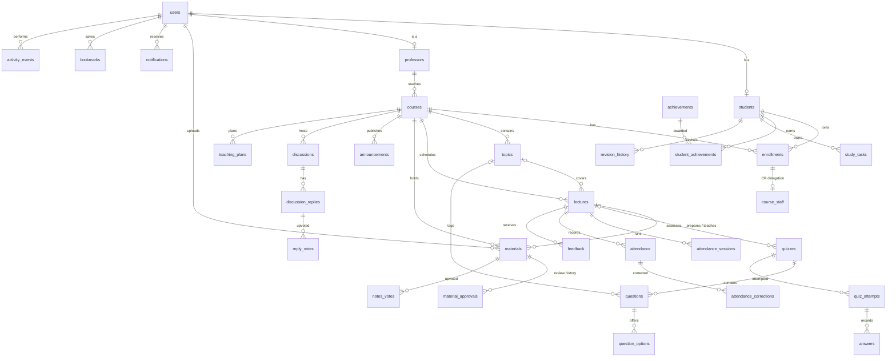

# ClassSync — PostgreSQL Data Design

PostgreSQL 17, accessed only through JDBC. Identifiers use `BIGINT GENERATED ALWAYS AS IDENTITY` (the PostgreSQL-native replacement for MySQL `AUTO_INCREMENT`). Instants are `TIMESTAMPTZ`; calendar days (streaks, due dates) are `DATE` computed in the configured academic timezone (`Asia/Kolkata` by default).

Tables are introduced by versioned migrations as modules are built:

| Migration | Tables |
|---|---|
| `V001__accounts_courses.sql` | `users`, `students`, `professors`, `courses`, `enrollments`, `course_staff`, `topics`, `lectures`, `audit_logs` |
| `V002__materials.sql` | `materials`, `material_approvals`, `notes_votes` |
| `V003__quizzes.sql` | `quizzes`, `questions`, `question_options`, `quiz_attempts`, `answers` |
| `V004__attendance.sql` | `attendance_sessions`, `attendance`, `attendance_corrections` |
| `V005__collaboration.sql` | `feedback`, `announcements`, `notifications`, `discussions`, `discussion_replies`, `reply_votes` |
| `V006__progress.sql` | `achievements` (5 seeded badges), `student_achievements`, `teaching_plans`, `bookmarks`, `revision_history`, `study_tasks` |
| `V007__admin_role.sql` | no new table: widens `users_role_check` to allow `ADMIN` (account administrators have no `students`/`professors` profile row) |

`schema_migrations` is created by the migration tool itself.

## ER diagram

## Tables and responsibilities

### Accounts
| Table | Responsibility | Key constraints |
|---|---|---|
| `users` | Login identity, role, PBKDF2 hash, theme preference | unique index on `lower(email)`; `role IN ('STUDENT','PROFESSOR','CR','ADMIN')` (ADMIN since V007) |
| `students` | Student/CR academic identity | PK = FK `users.id`; `enrollment_no` unique; semester 1–12 |
| `professors` | Professor identity | PK = FK `users.id`; `employee_no` unique |

A CR is a user with `role='CR'` **and** a `students` row: they keep every student feature. Their staff power exists only through `course_staff` rows.

### Courses
| Table | Responsibility | Key constraints |
|---|---|---|
| `courses` | Course with assigned professor | `code` unique; `archived_at` instead of deletion |
| `enrollments` | Student ↔ course | PK `(course_id, student_id)` prevents duplicates |
| `course_staff` | CR delegation per course | PK `(course_id, user_id)`; **FK `(course_id,user_id)` → `enrollments`** so a CR can only be staff in a course they are enrolled in; `ON DELETE CASCADE` removes delegation when unenrolled; one boolean per delegable permission |
| `topics` | Syllabus topics per course/unit | unique `(course_id, lower(name))` |
| `lectures` | Lecture unit | unique `(course_id, lecture_no)`; `ends_at > starts_at`; status `DRAFT/PUBLISHED/CANCELLED/COMPLETED`; unique `(id, course_id)` used by composite FKs |

### Resources
| Table | Responsibility | Key constraints |
|---|---|---|
| `materials` | Professor/CR materials **and** student notes (`kind='NOTE'`), PYQs, references | composite FK `(lecture_id, course_id)` → `lectures(id, course_id)` keeps lecture and course consistent; `CHECK ((kind='NOTE') = (review_status IS NOT NULL))`; `stored_path` unique and relative; size > 0 |
| `material_approvals` | Note review history | rejection requires a non-blank comment |
| `notes_votes` | One upvote per voter per note | PK `(material_id, voter_id)` |

### Quizzes (V003 — implemented)
| Table | Responsibility | Key constraints |
|---|---|---|
| `quizzes` | Settings: course, optional lecture, window, time limit, publication, review policy, practice switch | `closes_at > opens_at`; `duration_minutes` 1–300; `status IN ('DRAFT','PUBLISHED')`; `review_policy IN ('AFTER_SUBMIT','AFTER_CLOSE','MANUAL')`; FK `(lecture_id, course_id)` → `lectures(id, course_id)` |
| `questions` | MCQ / TRUE_FALSE with positive marks, optional syllabus topic and explanation | `marks` 1–100; unique `(quiz_id, position)`; unique `(id, quiz_id)` |
| `question_options` | Choices, including the answer key `is_correct` | partial unique index `question_options_one_correct` → at most one correct per question (the service requires exactly one); unique `(id, question_id)` |
| `quiz_attempts` | OFFICIAL vs PRACTICE attempts with an authoritative deadline | `student_id` → `students`; `mode IN ('OFFICIAL','PRACTICE')`; `status IN ('IN_PROGRESS','SUBMITTED','EXPIRED')`; unique `(quiz_id, student_id, attempt_no)`; partial unique indexes: one OFFICIAL attempt and one IN_PROGRESS attempt per student per quiz; `deadline_at > started_at`; `submitted_at` and `score` are set exactly when the attempt is finished; `score <= max_score` |
| `answers` | Saved (autosaved) answer per attempt/question, graded at submission | PK `(attempt_id, question_id)`; FK `(attempt_id, quiz_id)` → `quiz_attempts`, FK `(question_id, quiz_id)` → `questions`, FK `(option_id, question_id)` → `question_options` — so an answer can only point at a question of the attempt's quiz and an option of that question |

Total marks are **derived** (`SUM(questions.marks)`), never stored on the quiz; the scoring transaction copies the value into `quiz_attempts.max_score`. Deleting a quiz with attempts is blocked (`ON DELETE RESTRICT`); questions with answers cannot be deleted either.

### Attendance (V004 — implemented)
| Table | Responsibility | Key constraints |
|---|---|---|
| `attendance_sessions` | Code session for one lecture; stores SHA-256(lecture id + ":" + code), never the code | `status IN ('OPEN','CLOSED')`; partial unique index `attendance_sessions_one_open`: one OPEN session per lecture; `code_hash` is 64 hex chars; `closed_at` set exactly when CLOSED; `code_expires_at > started_at` |
| `attendance` | One row per student per lecture | PK `(lecture_id, student_id)` → duplicates impossible; `status IN ('PRESENT','ABSENT')`; `source IN ('CODE','FINALIZE','CORRECTION')`; a CODE row must name its session; `student_id` → `students` |
| `attendance_code_failures` | Wrong-code counter per student per session (limit 5, enforced by the app) | PK `(session_id, student_id)`; `failures > 0` |
| `attendance_corrections` | Professor corrections: before/after, reason, actor, time | `old_status <> new_status`; reason non-blank; FK `(lecture_id, student_id)` → `attendance`; **append-only** for `classsync_app` (UPDATE/DELETE revoked) |

`lectures.attendance_finalized_at` / `attendance_finalized_by` mark finalization; a lecture counts toward attendance only when it is finalized and not `CANCELLED`. Finalization inserts an ABSENT row (source FINALIZE) for every enrolled student without a record; a student's denominator is the number of counted lectures in which they have a record.

### Communication, progress and accountability
| Table | Notes |
|---|---|
| `feedback` (V005) | unique `(lecture_id, student_id)`; four ratings `CHECK BETWEEN 1 AND 5`; `anonymous` copied from the lecture setting at submission and never switched back off; `student_id` kept only for eligibility/uniqueness — professor queries select `NULL` instead of the name for anonymous rows |
| `announcements` (V005) | category `GENERAL/URGENT/CANCELLATION/ROOM_CHANGE/QUIZ/MATERIAL/ATTENDANCE_WARNING`; optional lecture via composite FK `(lecture_id, course_id)` |
| `notifications` (V005) | `kind`, `link_type` + `link_id` (which screen to open; the target page re-checks access, so no FK), `read_at`; **unique `(user_id, dedupe_key)`** + `ON CONFLICT DO NOTHING` → a retried action never notifies twice; written in the same transaction as the action |
| `discussions` / `discussion_replies` / `reply_votes` (V005) | resolved = `resolved_at` + `resolved_by` (set together, CHECK); moderation = `hidden_at` + `hidden_by` (kept for accountability); `topic_id` from the linked lecture feeds the doubt heatmap; PK `(reply_id, voter_id)` → one upvote per person |
| `achievements` / `student_achievements` (V006) | catalogue of 5 badges seeded by the migration; PK `(student_id, achievement_code)` — each badge at most once; separate from every marks table |
| `teaching_plans` (V006) | one row per syllabus topic (PK `topic_id`): planned date, hours, notes. Topic order = `topics.sequence`; status is derived from lectures whose `topic_id` points at the topic (no duplicated lecture link) |
| `bookmarks` (V006) | real FKs `material_id` / `lecture_id` / `discussion_id` (CASCADE); `CHECK (num_nonnulls(...) = 1)`; partial unique indexes per target; listing re-checks access, so a bookmark never reveals something the user can no longer see |
| `revision_history`, `study_tasks` (V006) | private per user; revision unique `(student_id, topic_id, revised_on)` — once per topic per academic day |
| *(no `activity_events` table)* | Design change during Phase 9: "meaningful activity" is derived with a UNION over records that already exist (submitted quizzes, code attendance, feedback, notes, doubts, replies, revisions, completed tasks). Viewing a screen writes nothing, so it cannot inflate streaks, and there is no second copy to keep in sync. |
| `audit_logs` | actor, action, entity, details (never passwords, codes or anonymous identities) |

## Delete behaviour

* Courses, lectures and materials with academic history are **archived** (`archived_at`) or set to `CANCELLED`; FKs from history tables use `ON DELETE RESTRICT`.
* A `DRAFT` lecture with no dependent rows may be deleted.
* Child detail rows (options of a question, answers of an attempt, approvals of a note, replies of a discussion) use `ON DELETE CASCADE`.
* User accounts are deactivated (`active=false`), not deleted.

## Plain-language relationships

* A professor teaches many courses; each course has exactly one professor.
* A student enrolls in many courses; an enrollment row links them. A CR's delegated permissions hang off that enrollment row.
* A course has many lectures; each lecture may cover one syllabus topic.
* Materials belong to a course and optionally to one of that course's lectures.
* A quiz belongs to a course (optionally a lecture), has questions, and each question has options with exactly one correct.
* A student's quiz attempt stores one answer per question.
* Attendance stores one row per student per lecture, created by code submission or by finalization (ABSENT).
